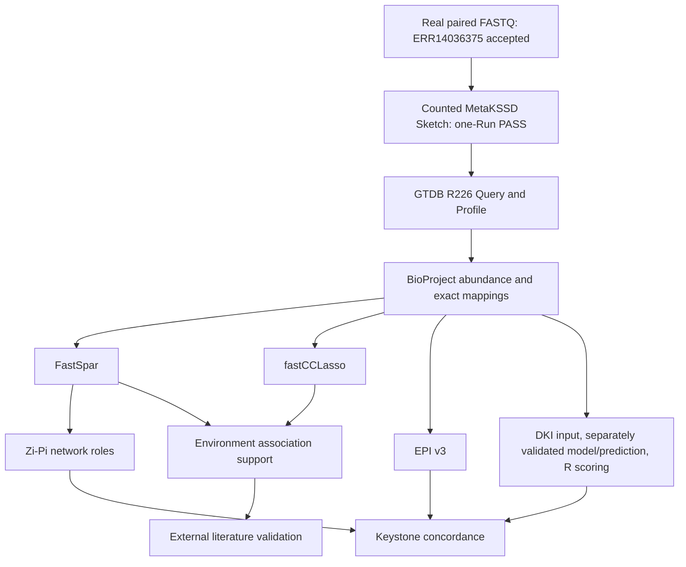

# MACK-DB processing workflow

Core entry/function guide: [CORE_WORKFLOW](docs/CORE_WORKFLOW.md). Database scope:264,767 processed samples from1,575BioProjects; primary keystone comparison:1,571BioProjects.

Start with the [bundled complete PRJEB81106 project](examples/real_bioproject/PRJEB81106/README.md) and [portable environments](environments/portable-matrix/README.md). Its `run_workflow.py --steps all` runs independent matrix branches, including new DKI training and unified-R scoring, in a fresh output directory. The single-Run FASTQ route is separate.

The generic commands below describe how to substitute other projects. Run them from the repository root with separately obtained, authorized inputs. Paths such as `data/...` and `PRJEXAMPLE` are placeholders, not bundled data or execution evidence. Use new isolated output roots. Commands below reproduce actual implemented CLI contracts; status and provenance are separate from whether a command can be parsed.



The methods are independent branches: EPI/DKI never require network inference. The new bundled example explicitly creates DKI perturbations, trains and predicts before scoring; saved-prediction replay remains a separate historical path.

## Evidence and entry contracts

| Status | Meaning |
|---|---|
| PASS | The stated bounded path has actual execution and output comparisons; not every branch or cohort |
| ARCHIVED_REPLAY | Fixed archived inputs and their documented semantics are replayed; genus uses the author-adopted name-token grouping |
| NOT_VERIFIED | Preparation/static documentation only, without relevant new execution |
| BLOCKED | Required inputs/rights/dependencies or a scientific/output-validity gate remain unresolved |

The [15-stage contracts](docs/PIPELINE_INPUT_OUTPUT_CONTRACTS.tsv) give each input format, parameters, outputs, downstream consumer and evidence. The [status matrix](docs/REPRODUCIBILITY_STATUS_MATRIX.tsv) distinguishes historical production, independent saved-Sketch reproduction and planned demonstrations. Every script's CLI and call edges appear in [SCRIPT_REFERENCE](docs/SCRIPT_REFERENCE.md).

## Real paired FASTQ → Sketch → Query → Species Profile

The accepted new route is **ERR14036375 only**, from the fixed PRJEB81106 archived33Run cohort. Read the [full acquisition, configuration, IO and acceptance guide](examples/real_fastq/ERR14036375/README.md). Reuse verified files or manually obtain its two ENA FASTQs (139,986,433bytes total); no script downloads data automatically and the other32Runs are not selected. No cohort matrix or DKI training claim follows from this one-Run result.

```bash
python pipeline/metakssd_profile/run_single_run.py data-info
cp -n config/single_run.example.json config/single_run.local.json
# Edit the local JSON paths to existing FASTQs, MetaKSSD, shuffle, MarkerDB and Rscript.
python pipeline/metakssd_profile/run_single_run.py preflight --config config/single_run.local.json
python pipeline/metakssd_profile/run_single_run.py run \
  --config config/single_run.local.json --output work/ERR14036375_first_run
python pipeline/metakssd_profile/run_single_run.py verify --output work/ERR14036375_first_run
```

The runner completely validates both compressed mates, preserves separate read records in one Run collection, then calls official MetaKSSD2.21 `dist -L L3K11.shuf -A -p 1 -m 2`, `composite -r MARKERDB -q SKETCH`, and the unchanged R Profile core with `-s 12`. It pins22-mer/shuffleID1481063132, actual reference hashes and original scientific parameters. [Pins](examples/real_fastq/ERR14036375/reference_pins.json) and [actual prior acceptance](examples/real_fastq/ERR14036375/accepted_evidence_summary.json) are small research references; binary, FASTQ, SRA, Sketch and MarkerDB are external.

Outputs are `sketch/`, `query/ERR14036375_all.txt` (seven columns), `profile/ERR14036375_profile.txt` (taxon label<TAB>percentage), complete logs/time-v/status and hashes. One new output root per run,600s external-stage limits, owned scratch only, failure retention, no retries or parameter fitting. Scientific key/count equality is checked independently of Sketch serialization/path bytes; Profile must be byte-identical. The existing saved-Sketch commands below remain available.

Historical complete argv/binary provenance remains limited. [SRA stream review](pipeline/metakssd_profile/HISTORICAL_SRA_STREAM.md) records the actual `fastq-dump --skip-technical --split-spot -Z` source fragment; `plan-sra` is nonexecuting and NOT_VERIFIED. The full AWS download/cleanup wrapper was not located and is not invented here.

## Query, Profile, abundance and counts

```bash
mkdir -p work/query work/profile work/abundance
bash pipeline/metakssd_profile/historical_linked_wrappers/query.sh \
  data/reference/marker_db data/sketch/SAMPLE_sketch work/query/SAMPLE_all.txt
Rscript pipeline/metakssd_profile/profile.R \
  -l data/sample_ids.txt -i work/query -s 12 -o work/profile
bash pipeline/metakssd_profile/historical_linked_wrappers/batch_matrix.sh \
  data/project_ids.txt data/project_samples work/profile work/abundance
```

`data/project_samples/{project}_uniq.txt` contains sample IDs matching Profile filenames. The unchanged adaptive f loop delegates to `pipeline/abundance/shape_sparcc_format.py`, and writes `work/abundance/filtered_{f}/abundance|species`. The path migration does not introduce sorting or renumbering beyond the original dictionary enumeration. Historical Python ordering across versions is still a reproduction limitation.

```bash
Rscript pipeline/abundance/count_sparcc.R \
  -i data/species/abundance/PRJEXAMPLE_abundance.matrix \
  -n 1000000 -o work/PRJEXAMPLE_count.matrix
```

Genus abundance follows the author's specified `SpeciesAbundanceMatrix_TO_GenusAbundanceMatrix.py`: extract the genus-prefix token from species labels, sum rows sharing that token and format four decimals. It folds some GTDB suffix genera rather than grouping the complete GTDB `g__` field. This rule already reproduced all38archived PRJEB81106 rows. The byte-identical original source is now included at `pipeline/abundance/SpeciesAbundanceMatrix_TO_GenusAbundanceMatrix.py`; the portable example stages filenames and compares all 1,254 genus abundance cells to the archive. See the [exact rule, filename-only staging and CLI](docs/GENUS_AGGREGATION_STATUS.md).

## FastSpar and final postprocessing

This inference command performs the historical10000-bootstrap protocol; it is **not** the small test:

```bash
MACKDB_THREADS=1 bash pipeline/associations/fastspar/run_fastspar.sh \
  work/PRJEXAMPLE_count.matrix work/PRJEXAMPLE
```

Executables may be selected with `FASTSPAR_BIN`, `FASTSPAR_BOOTSTRAP_BIN`, `FASTSPAR_PVALUES_BIN`, `PARALLEL_BIN`; default lookup uses PATH. Resource concurrency is configurable, scientific iteration counts are fixed to the reviewed script. Successful completion removes only its own bootstrap directories. Existing directories are not silently overwritten by `mkdir`.

```bash
python tools/network_matrix_io.py \
  --corr work/PRJEXAMPLE_correlation.tsv --pvalue work/PRJEXAMPLE_pvalues.tsv \
  --mapping data/species/species/PRJEXAMPLE_species.matrix --output work/PRJEXAMPLE_csv
Rscript pipeline/associations/fastspar/sparcc_corr_pvalue.R \
  -c work/PRJEXAMPLE_csv/correlation.csv -p work/PRJEXAMPLE_csv/pvalues.csv \
  -s data/species/species/PRJEXAMPLE_species.matrix \
  --corr_num 0.3 --pvalue_num 0.0001 -o work/PRJEXAMPLE_corr_pvalue
Rscript pipeline/associations/fastspar/corr_inter.R \
  -f work/PRJEXAMPLE_corr_pvalue.csv -n work/PRJEXAMPLE
```

The source postprocessor distinguishes CSV matrices with headers from its historical tabular no-header branch. The new IO adapter accepts labelled TSV matrices only when row and column IDs exactly match the mapping order, checks upper-triangle NA-mask agreement, and emits CSV without changing numeric strings. It rejects mismatches instead of silently reordering/transposing. Synthetic execution compares direct CSV and adapted TSV results. An unexpected upstream matrix format is an input error, not permission to guess its axes.

## fastCCLasso

The external official core is required. Species example preserves the original initial correlation filter and explicit final refilter:

```bash
Rscript pipeline/associations/fastcclasso/run_fastcclasso_parallel.R \
  --project PRJEXAMPLE --abundance_dir data/species/abundance \
  --species_dir data/species/species --output work/fastcclasso/species \
  --fast_core external/fastCCLasso/RCode/fastCCLasso.R \
  --nboot 100 --kmax 20 --pvalue 0.0001 --cor_cutoff 0.1 \
  --workers 1 --seed 20260804 --write_full_matrices T --write_pair_csv T
python pipeline/associations/fastcclasso/refilter_fastcclasso_cor0p3.py \
  --level species --work-root work/fastcclasso/species
```

The refilter writes to the explicitly chosen working root in place, just as its original scientific postprocessing did; never point it at production results. Genus uses `run_fastcclasso_parallel_genus.R`, `--species_dir data/genus/genus`, `--abundance_dir data/genus/abundance`, seed20260806, genus output root and `--level genus`. No P-value formula is recreated in a wrapper. The configured default core is not bundled; use the official pinned retrieval and SHA check in EXTERNAL_DEPENDENCIES.md. Full formal-parameter inference was executed in Stage2 on PRJEB81106; genus remains fixed archived-input replay. This is not a clean-install or full-cohort acceptance.

## Environment networks — conditional historical entry, not robust-output acceptance

**BLOCKED for unattended acceptance.** `get_link_info5.py` silently ignores missing/malformed pair files; project IDs/sample counts can outnumber coefficient/P vectors. Only `--tool fastspar` has an implemented file branch. Its five-decimal pre-rounding is unchanged from the archived reproduction source, not a new precision policy. See the [quality audit](docs/GET_LINK_INFO5_QUALITY_AUDIT.md). Prevalidate all files, exact support-ID uniqueness, edge existence, numeric finiteness and aligned vector lengths. No replacement implementation was introduced. These findings do not establish that formal data are corrupted.

Use the exact `_core_links_filtered.belonging` name below because the historical main derives environment labels by stripping that suffix. `-s/--source` is accepted but inactive in the current main. fastCCLasso uses its dedicated reader, not `get_link_info5.py --tool ccl_freq`.

```bash
python pipeline/environment/link_to_project.py \
  -l data/env/human_gut.list -d work/project_links -o work/environment \
  -n human_gut_core_links -f 2 -s T
python pipeline/environment/get_link_info5.py \
  -i work/environment/human_gut_core_links_filtered.belonging -o work/environment -n human_gut.info \
  -s data/projects.source -c work/corr_pv_csv -a data/species/abundance
```

For fastCCLasso use `pipeline/environment/fastcclasso/link_to_project_fastcclasso.py` with the same `-l/-d/-o/-n/-f 2/-s T` contract, then:

```bash
python pipeline/environment/fastcclasso/get_link_info_fastcclasso.py \
  -i work/environment/human_gut_core_links_filtered.belonging \
  -d work/fastcclasso/species/cor-pv_tsvformat -a data/species/abundance \
  -o work/environment -n human_gut_fastcclasso.info -e human_gut --rank species
```

Both support filters write `human_gut_core_links.belonging` (unfiltered) and `human_gut_core_links_filtered.belonging` (f=2). The attribute step must read the filtered file as above. The historical FastSpar filter console message mislabels the extension as .txt; the actual source writes .belonging. Do not infer a completed environment network from an empty/missing file alone.

## Zi-Pi

The full signed spin-glass/plotting entry retains the original computation. It now accepts data roots and taxonomy path:

```bash
Rscript pipeline/zipi/FastSpar_signed_spinglass_network.R \
  -p PRJEXAMPLE -l species -C data/networks/PRJEXAMPLE_corr.tsv \
  -P data/networks/PRJEXAMPLE_p.tsv --species-base data/species \
  --genus-base data/genus --taxonomy-file data/reference/bac120_taxonomy_r226_species_uniq.tsv \
  -f 0.3 --spins 25 --gamma 1 --gamma-minus 1 --seed 12345 \
  -a work/zipi/plots_a -b work/zipi/plots_b -c work/zipi/plots_c \
  -g work/zipi/gexf -d work/zipi/species_nodes
python pipeline/zipi/extract_signed_zipi_keys_by_environment.py \
  --level species --env-dir data/env --species-node-dir work/zipi/species_nodes \
  --species-out-dir work/zipi/species_keys --write-empty
python pipeline/zipi/prepare_signed_keys_for_mysql.py \
  --level species --species-dir work/zipi/species_keys --output-dir work/candidates
```

These last Python programs export local TSVs; they do not write MySQL. Full optimization and plots are not executed by small tests. A fallback basic node table after role failure is not equivalent to complete valid Zi/Pi output.

## EPI v3: recommended isolated single-project entry

```bash
python tools/epi_project.py --level species --project PRJEXAMPLE \
  --abundance data/species/abundance/PRJEXAMPLE_abundance.matrix \
  --mapping data/species/species/PRJEXAMPLE_species.matrix \
  --run-root work/epi_species/PRJEXAMPLE --rscript "$(command -v Rscript)"
```

For genus, change level, input paths and run root. The adapter checks matrix orientation/dimensions, exact ordered IDs/names and values. It copies the unchanged core and preserved worker into the new run root, freezes input/config hashes, then invokes `worker` and `postprocess`. It does not call the all-cohort `master`. Both ranks use exactly mode prevalence,.25–.75,pQ.1.

Outputs: three `keys/{project}_EPI-{D1,D2,Q}.key`, summary, status, raw logs, committed hashes and `final_2of3/{project}_EPI-2of3.key`. Zero-byte key files are accepted only with successful exit+summary+hash evidence. Resume the exact same command with `--resume`; it verifies the frozen setup and inputs and avoids rerunning successful projects. The production worker's per-file hard-link commits are unchanged; status/committed hashes determine complete success after an interruption.

The original workflow names remain in both rank paths. Their `ROOT` can be supplied by `MACKDB_EPI_RUN_ROOT`; config-relative core paths and PATH-resolved Rscript work without Dell paths. The separate full-genus adapter (`genus/scripts/prepare_inputs.py`) still requires the exact1575 formal list and historical pilot gates; it now initializes only an explicit isolated run root. It is not used as a toy-test shortcut and was not run on the full cohort.

For direct score diagnostics use the retained capture wrapper with `EPI_CAPTURE_CORE` set to the repository core and the same R CLI flags. `compare_saved_diagnostic_scores.R` now takes `REPRODUCED_ROOT AUDIT_DIR REFERENCE_VALIDATION_DIR`; its three named-project assertions are deliberately retained.

## DKI: accepted R scoring entry

Start from saved predictions if available; no training is required to rescore:

```bash
Rscript pipeline/dki/calculate_structural_keystoneness_rk4_fast.R \
  --project-list data/dki/projects.txt --data-base data/dki \
  --pred-base work/dki/species --threads 1
python pipeline/dki/map_keystoneness_species_names.py \
  --project-list data/dki/projects.txt --dki-base data/dki \
  --pred-base work/dki/species --species-dir data/species/species \
  --status-file work/dki/species/name_mapping_status.tsv
python pipeline/dki/prepare_dki_keys_for_mysql.py \
  --level species --species-root work/dki/species --env-dir data/env \
  --output-dir work/dki/candidates --sd-mode sample
```

`data/dki/{project}/data/` contains Ptrain/Ptest/species_id/sample_id CSVs; `work/dki/species/{project}/results/` contains qtrn/qtst. Check `reports/ks_rk4_fast_status.tsv`: `DONE`, `SKIP`, `NO_VALID_ROWS`, `MISSING_INPUT` and `FAILED` are distinct. The historical scorer can return process exit0 while reporting a failed project; its status table must be checked. This behavior is retained and tested where applicable, not concealed by the IO migration.

Genus mapping uses `map_keystoneness_genus_names.py --project-list ... --pred-base ... --genus-dir data/genus/genus --status-file ...`, followed by selection `--level genus --genus-root ...`. Neither export script writes a database.

`r_scoring_revision/score_R_streaming.R PROJECT DATA_DIR RESULT_DIR OUTPUT_DIR TOTAL_CASES` evaluates expressions from the adjacent accepted R scorer. It remains the specialized historical audit adapter and requires `OUTPUT_DIR/LOWMEM_REPRODUCTION.json` with PASS plus `taxon_name_map.tsv`. It is **not** a Lowmem/full-qtrn scoring implementation. Its gate must not be fabricated for real projects. The test uses a clearly labelled synthetic gate after checking the legacy counterexample. The regular R scorer above is the default published scoring entry.

For new DKI input, `generate_dki_input_from_abundance.py --project ... --abundance-dir ... --species-dir ... --out-base ...` implements the reviewed perturbation mapping. Training is intentionally excluded from quick tests. For explicitly requested new training, the actual accepted model command is:

```bash
python pipeline/dki/DKI_formula_fixed.py \
  --train-file data/dki/PRJEXAMPLE/data/Ptrain.csv \
  --test-file data/dki/PRJEXAMPLE/data/Ptest.csv \
  --output-dir work/dki/species/PRJEXAMPLE/results --project PRJEXAMPLE \
  --max-epochs 1000 --early-stop-patience 80 --lr 0.005 --batch-size 32 \
  --activation relu --bottleneck auto --normalize-z true --time-mode endpoint \
  --ode-method rk4 --ode-step-size 0.05 --device cpu --seed 20260629
```

Select the existing torch/torchdiffeq environment explicitly. The original default3000/200 does not describe the accepted production override1000/80.

## Keystone method concordance — final statistics; real inputs held

The synthetic Figure3 test is part of `python tests/run_small_tests.py`. The final unified-R real-data program is retained unchanged, but full real candidate data is not committed. Availability and SHA references are in docs/FIGURE3_INPUT_AVAILABILITY.tsv. Do not run the following until separately authorized inputs have been supplied under the ignored data/ directory:

```bash
python analysis/keystone_concordance/concordance_release.py \
  --base-analysis data/figure3/base_analysis \
  --scopes-dir frozen_inputs/figure3/scopes \
  --r-candidates data/figure3/r_replacement/FOUR_PROJECT_R_CANDIDATES_FINAL.tsv \
  --impact-audit data/figure3/impact_audit --output work/figure3
```

base_analysis must include inputs/key_{species,genus}{,_epi,_dki}.tsv plus FIGURE3_ALL_FOUR_SCOPES_22_VALUES.tsv; impact_audit must include FIGURE3_POTENTIAL_IMPACT.tsv. The accepted program checks the historical baseline, then replaces all four Species DKI projects with the61 accepted R candidates. Its intended final science is unified R, not mixed Lowmem. Do not pass already-replaced candidates as the historical baseline. Rendering is separate and was not run.

## External validation and final manuscript analyses

`docs/ANALYSIS_USAGE.tsv` binds retained analyses to the confirmed final manuscript. Supplementary MethodsS5/S7 use taxonomy, source-exclusion, null, recurrence and support-statistics code under analysis/external_validation. Supply actual external networks, taxonomy resources and frozen manifests through lib/mackdb_paths.py/config/paths.example.json. Missing inputs must stop an analysis; do not fabricate data or bypass SHA checks.

The final manuscript adopts720-order sequential recovery (MethodsS8) and Guo/Wallen complete-project comparison (MethodsS9). Fourteen existing final-result/helper sources, including the final residual-denominator recalculator and full-project code, are held pending individual author rights confirmation; see docs/PENDING_FINAL_STATISTICS_CODE.tsv. This candidate does not advertise a runnable finalS8/S9 entry while those files/inputs are absent. Retained Stage5B identity preparation and rewire code supply provenance/dependencies and are not the final full-project main program.

Figure2 numerical source is also identified but held. No missing final tableS7/S8 generator is asserted: the workbook containsTablesS1–S6; S7/S8 are Methods. TableS3 literature classifications are authored curation. The examples directory contains a bundled complete-project matrix runner and a separate accepted one-Run FASTQ runner. The old Stage2 archived-input/scoring-replay runner remains for historical compatibility. Fresh FASTQ processing for all 33 Runs is not claimed.


## PRJEB81106 complete-project matrix example

See the [complete-project guide](examples/real_bioproject/PRJEB81106/README.md). The bundle includes the original 53×33 species matrix, 38×33 genus matrix, exact taxon mappings, ordered Run IDs, minimal taxonomy and small archived references. Default use requires no private JSON paths or saved predictions.

```bash
"$MACKDB_PYTHON" examples/real_bioproject/PRJEB81106/run_workflow.py --steps all --preflight
"$MACKDB_PYTHON" examples/real_bioproject/PRJEB81106/run_workflow.py --steps all --output work/PRJEB81106
```

The runner uses formal scientific parameters, new isolated output roots, per-stage logs/checksums/status, and a configurable finite stage timeout (default 600s). `--resume` reuses only successfully validated unchanged artifacts. It never retries failures, downloads data or installs software. New FastSpar output feeds Zi-Pi directly. EPI is matrix-only; DKI generates its own perturbations and neural predictions. Legal zero candidates are successful if the core status and complete outputs validate. The exact tool configuration and Linux environment setup are documented in [portable environments](environments/portable-matrix/README.md). The original `run_stage.py` remains an archived-input/scoring-replay route, not the default.
