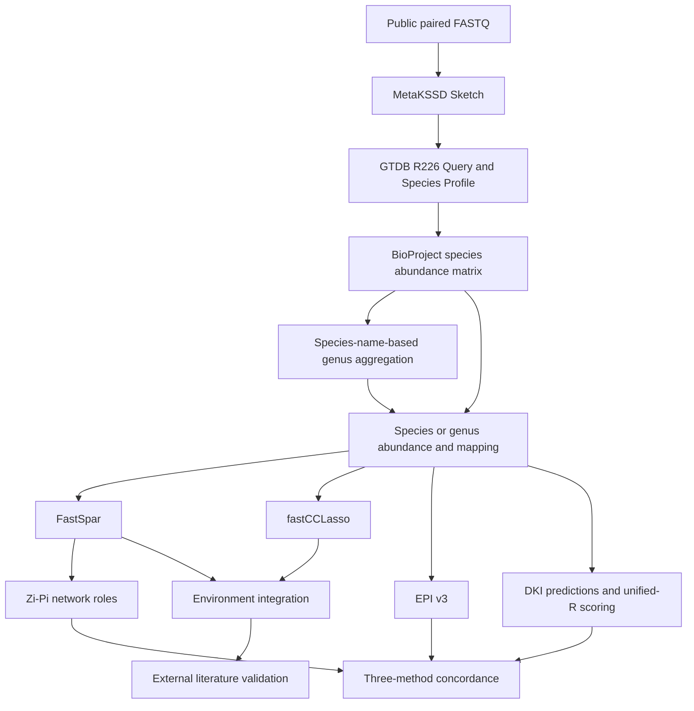

# MACK-DB

MACK-DB (Microbial Association and Candidate Keystone Database) organizes microbial associations and candidate keystone taxa from **264,767 processed metagenomic samples, 1,575 BioProjects and 45 environments**. Results retain their supporting BioProjects. The main three-method keystone comparison uses a separately fixed set of 1,571 BioProjects.

This repository contains the scientific workflow, required helpers, small tests and a **complete real 33-sample BioProject matrix example**. It is not a copy of the production database or a bulk research-data archive.

## Scientific workflow



**Zi-Pi requires a network. EPI and DKI use abundance matrices and do not require FastSpar or each other.** Genus abundances follow the original species-name parsing rule: species sharing the extracted genus-prefix token are summed with four-decimal output. This can fold GTDB genus suffixes; it is not strict grouping by the complete GTDB `g__` field. See the [exact rule](docs/GENUS_AGGREGATION_STATUS.md).

## Start here

1. Read [INSTALL](INSTALL.md) to configure software and external references.
2. Use [CORE_WORKFLOW](docs/CORE_WORKFLOW.md) for the core scripts, functions, inputs and outputs.
3. Follow [PIPELINE](PIPELINE.md) for actual commands and execution order.
4. Choose an example:
   - [ERR14036375: paired FASTQ to Species Profile](examples/real_fastq/ERR14036375/README.md). This one-Run route was actually executed; the final Profile is byte-identical to its archived reference.
   - **Recommended downstream start:** [PRJEB81106 complete 33-Run matrices](examples/real_bioproject/PRJEB81106/README.md), bundled with mappings and small references. The portable runner branches to FastSpar→Zi-Pi, fastCCLasso, EPI and fresh DKI training→unified-R scoring. No FASTQ download is needed for this route.

Configure the [Linux environments and external tools](environments/portable-matrix/README.md), then run:

```bash
"$MACKDB_PYTHON" examples/real_bioproject/PRJEB81106/run_workflow.py --steps all --preflight
"$MACKDB_PYTHON" examples/real_bioproject/PRJEB81106/run_workflow.py --steps all --output work/PRJEB81106
```

`--steps all` explicitly includes new CPU model training at both taxonomic levels. To run EPI alone, use `--steps epi`. Software paths can be supplied through [the configuration template](config/portable_matrix.example.json); no Dell path is required.

[TESTING](TESTING.md) records the nine small scientific groups and twelve workflow safety cases that already passed. Regression commands are optional for users; reading this workflow does not require another acceptance campaign.

## Repository guide

| Location | Purpose |
|---|---|
| `pipeline/` | Profile/matrices, associations, Zi-Pi, EPI v3, unified-R DKI and environment integration |
| `analysis/keystone_concordance/` | General three-method concordance statistics |
| `analysis/external_validation/` | Literature taxonomy mapping, source exclusion and validation statistics |
| `examples/` | Real one-Run FASTQ and archived 33-Run matrix examples |
| `tests/` | Small synthetic inputs, expected outputs and regression code |
| `tools/`, `lib/`, `config/` | Required adapters, shared path handling and nonsecret configuration templates |
| `docs/` | Core/full script references, methods and provenance |

The [GitHub content guide](docs/GITHUB_CONTENTS.md) explains what belongs in this code release. Bulk reads, whole-cohort matrices, Sketches, MarkerDBs, predictions and historical audit collections are not GitHub payloads. The small real-project matrix bundle is included specifically to make the downstream example self-contained. Detailed concordance-data instructions remain in the [frozen-input guide](frozen_inputs/figure3/README.md).

## Scientific versions and documented scope

EPI uses the accepted v3 core; DKI uses unified-R scoring release `MACKDB_DKI_R_20261012_v1`. Algorithms, scientific parameters and accepted results are unchanged. The [full script index](docs/SCRIPT_REFERENCE.md) describes all 82 retained scripts, including runtime dependencies and tests; they are not 82 independent processing stages.

See [PARAMETERS](PARAMETERS.md), [REPRODUCIBILITY](REPRODUCIBILITY.md), [EXTERNAL_DEPENDENCIES](EXTERNAL_DEPENDENCIES.md) and [THIRD_PARTY_SOFTWARE](THIRD_PARTY_SOFTWARE.md). Full manuscript/cohort reproduction and a clean installation on a second server are not claimed. The complete-project example has its own explicit execution evidence and boundaries. Additional final-statistics sources awaiting release-rights confirmation, data access, project licensing and the separate website implementation are listed in [follow-up items](docs/FOLLOW_UP_ITEMS.md); they do not require repeating the core analyses.
