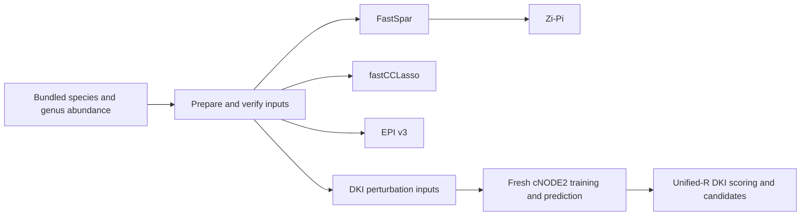

# PRJEB81106: complete BioProject matrix example

Use this example to start from a **complete, bundled BioProject abundance matrix**, then run network inference, Zi-Pi, EPI v3 and fresh DKI training/scoring on a Linux server. No FASTQ download or private matrix path is needed. The default entry is [run_workflow.py](run_workflow.py); the earlier `run_stage.py` is retained only for explicitly archived replay.

The frozen cohort is **33 archived Run samples**, with a **53 × 33 species matrix** and a **38 × 33 historical genus-group matrix**. It is not the current, larger public BioProject cohort. The [bundled directory](bundled/README.md) contains 27 files totaling 161,081 bytes: matrices, exact taxon and sample mappings, ordered accessions, two minimal taxonomy references, small expected outputs and provenance/checksums. No saved neural predictions or model checkpoint is included.

## Independent analysis branches



Zi-Pi requires a network. EPI and DKI consume abundance directly and do not depend on FastSpar or fastCCLasso. The two association tools are separate branches, not sequential requirements for each other. `--steps all` explicitly requests all branches for both ranks, including new DKI training and prediction.

## 1. Configure a Linux environment

Follow [the portable environment instructions](../../../environments/portable-matrix/README.md) for Python ≥3.11, the R runtime and packages, FastSpar 1.0.0 plus GNU parallel, the separately obtained pinned fastCCLasso core, and the DKI torch/torchdiffeq interpreter. No software is installed by this workflow. Clean-server environment reconstruction has not yet been independently verified; the instructions distinguish observed local versions from installation recipes.

From the repository root, copy the non-sensitive configuration template and edit executable paths for your own server:

```bash
cp config/portable_matrix.example.json config/portable_matrix.local.json
```

The [template](../../../config/portable_matrix.example.json) configures the three FastSpar programs, `parallel`, and `fastcclasso_core`. The interpreter keys are intentionally omitted so the exported `MACKDB_PYTHON`, `MACKDB_RSCRIPT` and `MACKDB_DKI_PYTHON` from the environment guide apply. You may add `python`, `rscript` and `dki_python` as explicit absolute paths; explicit configuration overrides the environment. Bare program names resolve on `PATH`; configuration file paths resolve relative to the JSON file. No Dell path is required. Explicit CLI tool options override the corresponding configuration values. Keep GNU parallel and the configured FastSpar environment on `PATH` as described in the environment guide.

```bash
# MACKDB_PYTHON is the Python>=3.11 orchestration interpreter saved during setup.
# MACKDB_DKI_PYTHON is the separate model interpreter, not a replacement for it.
: "${MACKDB_PYTHON:?Follow the environment guide and select the orchestration Python}"
EXAMPLE=examples/real_bioproject/PRJEB81106/run_workflow.py
CONFIG=config/portable_matrix.local.json
"$MACKDB_PYTHON" "$EXAMPLE" --help
```

Check the exact prerequisites for all requested branches without starting a scientific analysis:

```bash
"$MACKDB_PYTHON" "$EXAMPLE" --config "$CONFIG" --steps all --preflight
```

Default invocation without `--steps` is also a prerequisite check only. The input checks verify SHA256, 33-Run order, finite nonnegative values, taxon mappings and accepted scientific source identities. A missing dependency stops with a concrete error; the runner does not install a substitute version or change parameters.

## 2. Start with a complete matrix branch

For an abundance-only first run, check and execute EPI independently. This does not require the FastSpar or DKI training environment:

```bash
"$MACKDB_PYTHON" "$EXAMPLE" --config "$CONFIG" --steps epi --preflight
"$MACKDB_PYTHON" "$EXAMPLE" --config "$CONFIG" --steps epi \
  --levels species genus --output work/PRJEB81106_epi
```

Run both complete-project workflows, including actual CPU DKI training, in a new output directory:

```bash
"$MACKDB_PYTHON" "$EXAMPLE" --config "$CONFIG" --steps all \
  --levels species genus --output work/PRJEB81106_complete \
  --threads 4 --timeout-seconds 600
```

`--levels species` or `--levels genus` selects one rank. `--steps` accepts one or more of `prepare`, `fastspar`, `fastcclasso`, `zipi`, `epi`, `dki-input`, `dki-train`, `dki-score`, or `all`. Prerequisites are included automatically:

| Requested step | Automatically included prerequisites | Main product |
|---|---|---|
| `prepare` | None | Checked, isolated matrix inputs; genus reconstructed with the original converter. |
| `fastspar` | `prepare` | Correlation, covariance, P values and filtered associations. |
| `fastcclasso` | `prepare` | Independent fastCCLasso correlations/P values and associations. |
| `zipi` | `prepare`, `fastspar` | Network nodes/roles, edges and candidate tables. |
| `epi` | `prepare` | D1/D2/Q results, status and 2-of-3 candidates. |
| `dki-input` | `prepare` | Ptrain/Ptest and perturbation sample/taxon indices. |
| `dki-train` | `prepare`, `dki-input` | A newly trained cNODE2 model and newly generated qtrn/qtst. |
| `dki-score` | `prepare`, `dki-input`, `dki-train` | Unified-R Ks summaries/ranks and final DKI candidates. |
| `all` | All listed steps | All independent branches for the selected ranks. |

Examples of selecting one branch:

```bash
"$MACKDB_PYTHON" "$EXAMPLE" --config "$CONFIG" --steps zipi \
  --output work/PRJEB81106_zipi
"$MACKDB_PYTHON" "$EXAMPLE" --config "$CONFIG" --steps dki-score \
  --output work/PRJEB81106_fresh_dki
```

The latter command **trains and predicts first**. It does not use saved qtrn/qtst or substitute historical scores. No new training candidate count is promised to equal a previous stochastic run solely because a fixed seed is recorded.

## 3. Scientific parameters and completion evidence

The runner delegates to the accepted scientific programs. It retains formal FastSpar 10,000 bootstrap/permutation replicates, fastCCLasso `nboot=100` and `kmax=20`, EPI v3 prevalence 25%–75% and the corrected Q/ECDF definition, and unified-R DKI scoring. DKI uses explicit CPU training with the recorded optimizer/model settings, seed and early stopping. The original genus converter is also checked against its source SHA. Read [PARAMETERS](../../../PARAMETERS.md) and [PIPELINE](../../../PIPELINE.md) for formula and entry details; the command logs record actual argv.

Outputs must be under a new `work/` directory inside the checkout or a separate external directory. Every completed step has `SUCCESS.json` with artifact SHA256 and output checks; errors preserve `FAILED.json` and `WORKFLOW_STATUS.json`. An empty candidate table or a valid zero-node genus network is not a failure when the step's scientific checks and completion record pass. Never infer success merely from an existing or nonempty output filename.

The default timeout is **600 seconds per stage**. On a slower server, explicitly choose a larger positive finite `--timeout-seconds` value before running; that changes only the execution limit, not scientific parameters. A timeout terminates its child process group, keeps logs and does not retry or lower bootstrap/model settings.

Reuse only completed, unchanged stages by explicitly adding `--resume` with the same output root:

```bash
"$MACKDB_PYTHON" "$EXAMPLE" --config "$CONFIG" --steps all \
  --levels species genus --output work/PRJEB81106_complete \
  --threads 4 --timeout-seconds 600 --resume
```

Resume checks the input bundle, scientific sources, tool-path identities and recorded artifact checksums. It does not silently accept partial outputs; an incomplete prior stage must be inspected, then rerun in a fresh output root. For an intentionally separate experiment, use a new output directory.

## 4. References and validation scope

The small [expected output files](bundled/expected/) come from the accepted Stage2 local formal-parameter matrix runs. Those historical runs produced species FastSpar 25 selected associations and genus FastSpar 3; species Zi-Pi 6 nodes/4 edges and genus Zi-Pi a legitimate empty network; EPI had 3 eligible species and 2 eligible genus groups with zero candidates. These values remain historical references, not inputs that replace a new computation. Build, randomization and numerical differences must be reported separately from successful execution; never rewrite the reference values merely to obtain PASS.

On 2026-10-21, the new complete `--steps all` route actually passed all **16 rank/stage combinations**, including one new CPU training/prediction run per rank and unified-R scoring. Total wall time was 188.03 seconds on the existing server with eight FastSpar workers. Species/genus training took 15.05/11.45 seconds, stopping normally at epochs109/128 under the unchanged max1000/patience80 settings. Both ranks produced three DKI candidates. All FastSpar correlation/covariance/P values matched the archived references with maximum absolute difference0. Genus conversion matched all1254 cells. The [execution table](../../../tests/expected/PORTABLE_MATRIX_EXECUTION_20261021.tsv) records each stage. This is real training, not saved-prediction replay.

This is existing-server execution and subsequent checkout relocation, not a fresh installation on a second machine. The final wrapper also accepts the original selector's legal `NO_CANDIDATES` status; the formal run above returned `OK`. No scientific algorithm, threshold or expected numerical value was changed. Installation instructions alone are not execution evidence. Read your own `SUCCESS.json` and `WORKFLOW_STATUS.json`; a new build or stochastic training run is not promised bitwise equality.

The [minimal taxonomy references](bundled/README.md) preserve original fields and were read with the original Zi-Pi R parsing/deduplication rules. All 53 species and 38 genus annotations match the corresponding entries of the original full reference exactly. GTDB R226 attribution and applicable upstream terms must be retained.

The genus matrix uses the author-adopted historical name-token aggregation: the specified converter extracts `label.split(' ')[0].split('_')[1]`, sums matching rows per sample and writes four decimals. This folds some GTDB suffix genera; it is not strict complete-GTDB-genus aggregation. The frozen 38 × 33 matrix is retained without renormalization. See the [converter contract](../../../docs/GENUS_AGGREGATION_STATUS.md).

## 5. Separate entry points and limits

- [ERR14036375 FASTQ example](../../real_fastq/ERR14036375/README.md) is a genuinely accepted single-Run upstream FASTQ→Sketch→Query→Profile test. This complete-project matrix example needs no FASTQ and does not claim that all 33 Runs have newly passed the upstream workflow.
- [run_stage.py](run_stage.py) remains **ARCHIVED_REPLAY** compatibility code. Its [old templates](inputs.example.json) require external private input JSON and pinned historical hashes. In particular, `--stage dki-replay` scores saved matched predictions and does not train. It is not the default public matrix workflow and is not a substitute for fresh `dki-train`/`dki-score`.
- This complete-project example does not rerun 1575 projects or reproduce every final manuscript result. Fourteen unrelated additional source files remain held for rights confirmation.
- The author authorized local preparation of the complete-project matrix example. No upload or public release has occurred. Final source/data licensing and clean-server installation verification remain explicit release considerations; they do not prevent configuring and using this local example.

See [the environment guide](../../../environments/portable-matrix/README.md), [bundled input provenance](bundled/SOURCE_PROVENANCE.tsv), [bundle SHA256](bundled/SHA256SUMS.tsv), [DATA_AVAILABILITY_GUIDE](../../../DATA_AVAILABILITY_GUIDE.md) and [the general pipeline](../../../PIPELINE.md).
